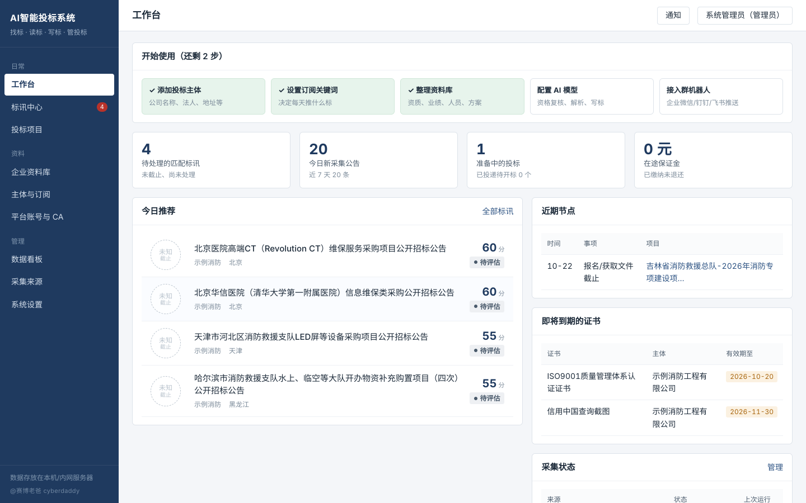
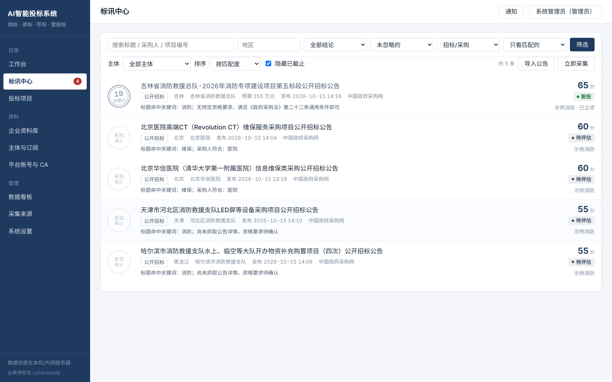
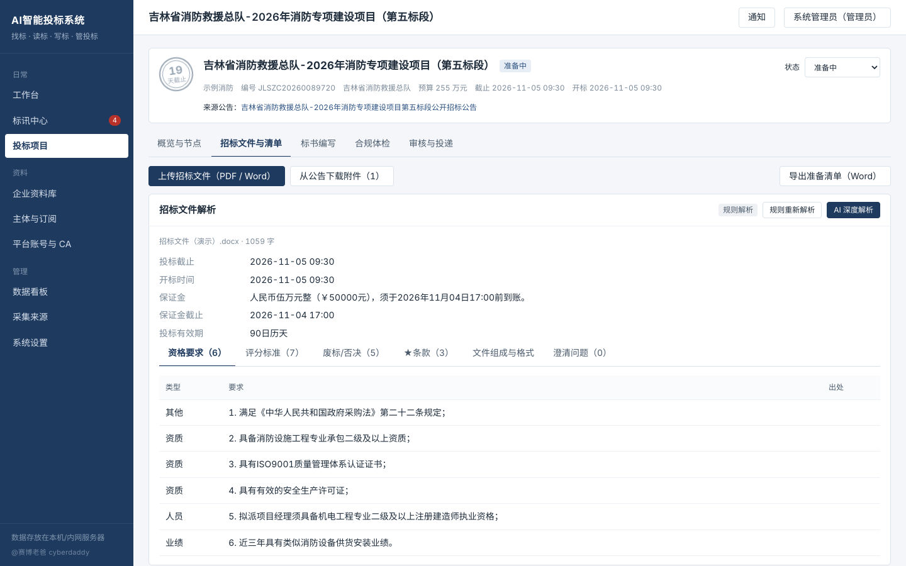
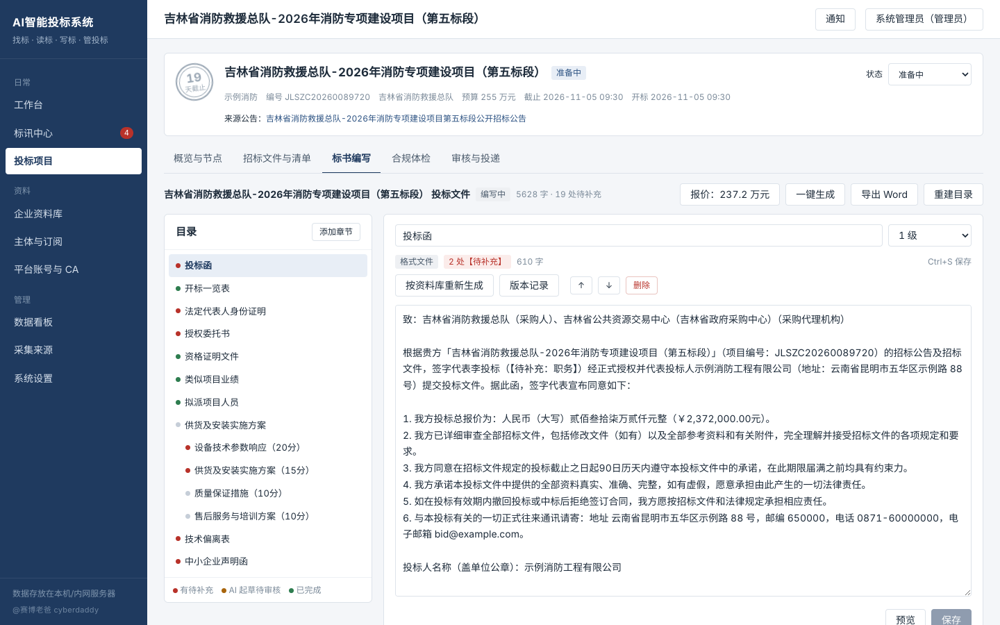
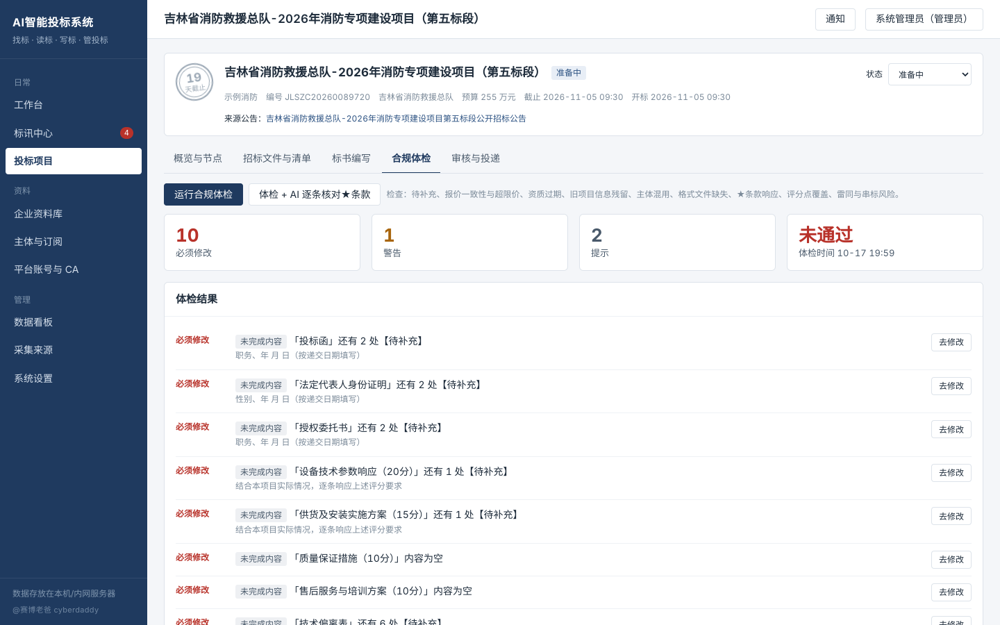

# AI智能投标系统 · 开源基础版 v1.1.1

帮企业每天自动找到「自己能投、值得投」的标，用 AI 把公司已有的真实资料按甲方要求组装成标书，并把投标全过程管起来。

**找标 → 读标 → 写标 → 防废标 → 管投标 → 复盘**，一套系统打通。

| 工作台 | 标讯中心 |
|---|---|
|  |  |
| **招标文件解析** | **标书编写** |
|  |  |
| **合规体检** | |
|  | |

> 截图使用内置演示数据：「示例消防工程有限公司」为虚构主体，公告为中国政府采购网公开发布的公告样本。

---

## 一、功能一览

| 板块 | 能做什么 |
|------|---------|
| 标讯采集 | 定时增量采集中国政府采购网（中央/地方的招标、磋商、更正、中标、成交公告）；可添加省市交易中心、高校医院国企等任意公告列表页；支持粘贴链接或正文手动导入 |
| 智能匹配 | 按「订阅画像」（关键词/排除词/地区/品目/采购人/预算）过滤打分；对照资料库给出 **能投 / 差一项 / 不能投 / 待评估**，并写明理由和缺什么；配置 AI 后自动复核资格 |
| 标讯中心 | 按匹配度、截止时间、预算排序筛选；详情里有公告要点、资格要求原文、各主体匹配结论、同一项目的其他转载、**该采购人历史中标记录**；一键 AI 大白话解读 |
| 企业资料库 | 基础资料、资质证书（有效期提醒）、业绩、人员（在建占用）、方案素材、历史标书；上传证书扫描件；PDF/Word 方案一键导入成可检索素材 |
| 招标文件解析 | 上传 PDF/Word（或从公告一键下载附件），解析资格要求、评分标准、废标/否决条款、★实质性条款、文件组成与格式、关键时间与保证金；AI 深度解析还会列出可以向招标人澄清的问题 |
| 投标准备清单 | 每一项要求对照资料库：已具备 / 已过期 / 等级不足 / 缺失 / 需人工确认；可导出 Word 清单 |
| 标书编写 | 按招标文件目录自动搭框架；投标函、授权书、声明函等**格式文件按资料库自动填写**；资格证明、业绩、人员**只引用资料库真实条目**；技术方案按**评分点逐条**生成章节，AI 起草、改写、对照评分点补全；报价表自动算合计和大写金额并同步到投标函；版本记录可回退；导出带封面、目录、页眉页码的 Word |
| 合规体检 | 待补充项、报价超限价、大小写不一致、投标函与报价表不一致、资质过期、旧项目名称/编号残留、其他主体名称混入、格式文件缺失、★条款响应、评分点内容过少、**同一项目多主体参与的串标风险与雷同度** |
| 投标项目管理 | 看板（待评估→准备中→审核中→待投递→已投递→已开标）；报名/答疑/保证金/截止/开标节点倒计时提醒；保证金缴纳退还；审核流（体检未通过不能直接定稿）；投递登记与回执；结果登记 |
| 结果跟踪 | 采集到中标公告时自动关联到在投项目并通知（"疑似中标"）；结果登记后技术方案自动存入历史标书库 |
| 平台账号与 CA 台账 | 各交易平台注册情况、CA 证书持有人与到期提醒（**不保存任何密码**） |
| 推送 | 企业微信 / 钉钉 / 飞书群机器人：新匹配标讯、每日早报、节点提醒、证书到期提醒 |
| 数据看板 | 每月采集→匹配→立项→投递→中标漏斗、中标率、按地区统计、常见竞争对手、AI 用量 |
| 系统 | 多主体（集团多家公司资料隔离）、六种角色权限、操作日志 |

---

## 二、怎么打开

- [下载 v1.1.1 Mac 安装包（Apple 芯片）](https://github.com/cyberdaddyleo/AItoubiao/releases/download/v1.1.1/AI-Bidding-System-macOS-arm64-v1.1.1.zip)
- [查看版本说明](https://github.com/cyberdaddyleo/AItoubiao/releases/tag/v1.1.1) · [下载 v1.1.1 源码](https://github.com/cyberdaddyleo/AItoubiao/archive/refs/tags/v1.1.1.zip)

| 场景 | 用什么 | 说明 |
|------|--------|------|
| **Mac 本机用**（Apple 芯片） | Release 附件 `AI-Bidding-System-macOS-arm64-v1.1.1.zip` 里的 **AI投标系统.app** | 自带运行环境，不用装任何东西。双击自动启动、自动登录、打开浏览器。第一次打开需要在系统里放行一次，见 zip 里的「Mac版使用说明.md」 |
| **Windows 本机用** | 双击 **Windows双击启动.bat** | 需要先装 Python 3.10+。第一次会自动装依赖（1~3 分钟），之后双击即用，关闭黑色窗口即停止 |
| **团队一起用 / 上线网站** | Docker 部署到服务器 | 见下面「服务器部署」 |

本机版（Mac / Windows）只监听本机、自动登录；第一次会问是否载入演示数据（虚构的「示例消防工程有限公司」，带资料库、订阅、用真实公告样本生成的标讯和一个进行中的项目，正式使用前在「主体与订阅」里删掉即可）。
每次启动时，如果距上次采集超过 1 小时会自动补采一次。

### 服务器部署（网站版，多人使用）

```bash
cp .env.example .env          # 可在 .env 里设置管理员初始密码
docker compose up -d --build
```

浏览器打开 `http://服务器IP:8600`。数据都在 `./data` 目录。管理员在「系统设置 → 用户与角色」里给同事开账号。

- 首次登录：账号 `admin`，初始密码在 `data/初始管理员密码.txt`（或用 `.env` 里的 `BID_ADMIN_PASSWORD` 指定），登录后在右上角改密码；
- 要采集国内政府采购网站，服务器建议放在中国大陆（阿里云、腾讯云等）；用域名对外访问需要先做 ICP 备案，并配置 HTTPS；
- 没有 Docker 的 Linux 服务器也可以 `./start.sh` 直接运行（需要 Python 3.10+）。

### 重新打包 Mac 应用

改了代码之后，在任意能联网的电脑上运行：

```bash
pip install zstandard pillow
python packaging/macos/build_app.py
```

产物在 `dist/`。运行环境取自 conda-forge 的 macOS arm64 Python 3.12，依赖按 macOS 平台下载，整个过程约 1 分钟。

---

## 三、上手 5 步

系统工作台会显示这 5 步的完成情况。

1. **添加投标主体**（主体与订阅 → 添加主体）：公司全称、法人、信用代码、地址、联系人等。投标函、授权书会自动用这些信息填写。
2. **设置订阅**：写具体的业务词，例如「消防, 火灾报警, 喷淋」，排除词例如「食堂, 物业」。保存后点「用最近 7 天公告重新匹配」立即看效果，「预览效果」可以看能匹配到哪些。
3. **整理资料库**：资质证书一定要填有效期；证书扫描件上传 JPG/PNG，导出标书时会自动插入；方案素材越多，AI 写得越贴合你们公司。
4. **配置 AI 模型**（系统设置 → AI 模型）：选常用模型自动填好地址，填 API Key，点「测试连接」。
5. **接入群机器人**（系统设置 → 群机器人推送）：贴上企业微信/钉钉/飞书群机器人的 Webhook。

之后的日常：每天早上看推送或工作台 → 打开值得投的标讯 → 立项 → 上传招标文件 → 看准备清单补资料 → 创建标书、填报价、一键生成 → 体检 → 提交审核 → 投递登记 → 登记结果。

---

## 四、AI 模型

不配置 AI 也能用：采集、规则匹配、规则解析、格式文件、资料引用、合规体检、导出都不依赖 AI。
配置后启用：资格复核、标讯解读、招标文件深度解析、技术方案起草与改写、★条款逐条核对。

| 选择 | 说明 |
|------|------|
| DeepSeek / 通义千问 / 豆包 / 智谱 / Kimi | OpenAI 兼容接口，选好后填 API Key 即可。豆包需要填「推理接入点 ID」作为模型名 |
| 本地 Ollama | 私有化部署，数据不出内网。地址 `http://localhost:11434/v1`（Docker 部署时改成宿主机地址） |
| Anthropic Claude | 选「Anthropic Claude」并填 Key |

**数据安全提醒**：调用 AI 时会把招标文件内容和企业资料摘要发给所选模型服务商。标书属于商业机密，建议使用国内合规的模型服务或私有化部署。

**AI 写标的约束（写在代码里）**：AI 只依据招标文件原文、项目信息和资料库方案素材写作；不写证书、业绩、人员（这些只能从资料库引用）；没有依据的数字写【待补充】；生成内容里如果出现其他主体名称会被自动替换为待核实占位；所有 AI 章节标记「待审核」，体检会提醒。

---

## 五、采集说明（合规）

- 只采集公开发布的公告页面，不登录、不采集付费内容；
- 默认遵守 robots.txt；每个网站限速（中国政府采购网栏目页默认间隔 4 秒）；
- 遇到 403/429、「访问过于频繁」页面或验证码要求，**立即停止并暂停该来源 6 小时**，并在通知里提示；系统**不会识别或绕过验证码，也不使用代理换 IP**；
- 每条公告保存原文快照和 SHA-256 摘要，便于追溯。

内置来源（2026-10-15 实测）：

| 来源 | 状态 | 说明 |
|------|------|------|
| 中国政府采购网·栏目列表 | 默认启用 | 按栏目增量采集，翻到已采集的公告就停。地方公开招标栏目更新很快（一页 20 条只覆盖几分钟到几十分钟），默认工作时间每小时采集一次；可在「采集来源 → 设置」里勾选栏目 |
| 中国政府采购网·关键词搜索 | 默认关闭 | 用订阅关键词全站搜索补漏。该站搜索限频非常严，短时间第二次请求就会被拦，开启后每个关键词间隔 40 秒 |
| 全国公共资源交易平台 | 默认关闭（实验性） | 列表接口已核实，但该站限频严格并可能要求图形验证码，遇到即暂停；详情页用通用正文提取 |
| 自定义列表页 | 自己添加 | 省市公共资源交易中心、高校/医院/国企采购栏目。填列表页地址，点「测试」看解析效果再保存 |

详情抓取策略默认「只抓标题命中订阅的」，请求最少；如果担心关键词只出现在正文里漏掉，可在「系统设置 → 采集与提醒」改成「全部抓取」。

---

## 六、「统一投递」是怎么做的

国内电子招投标平台投标时需要在各平台注册、用 **CA 数字证书加密签章**、很多还要用平台专用的投标客户端。所以系统的做法是：

- 系统负责：生成标书、合规体检、审核定稿、导出 Word、准备清单、节点提醒、平台账号与 CA 台账；
- 经办人负责：在官方平台用 CA 证书加密上传（这一步不能也不应由系统代替）；
- 上传成功后回到系统「审核与投递」登记投递信息、上传回执截图。

---

## 七、日常运维

- **备份**：备份 `data` 目录即可（数据库 `bidding.db`、上传文件 `files/`、导出文件 `exports/`、公告快照 `snapshots/`）。建议每天定时复制一份。
- **升级**：先备份 `data` 目录，再替换代码并重启（Docker：`docker compose up -d --build`）。
- **端口/时区**：环境变量 `BID_PORT`、`BID_TZ`。
- **对外访问**：建议放在内网，或用 Nginx 加 HTTPS 反向代理后再对外。
- **接口文档**：登录后访问 `/api/docs`。

---

## 八、已知限制与验证状态（v1.1.1）

- 扫描件 PDF 需要先 OCR 成可复制文字再上传（系统会提示「疑似扫描件」）；旧版 `.doc` 需另存为 `.docx`。
- 规则解析对格式规范的招标文件效果好，格式特殊的建议用「AI 深度解析」，解析结果可以人工核对。
- 规则资格初判只认得明确写出的证书名称、资质等级、注册资本等，看不懂的条款标「需人工确认」。
- 全国公共资源交易平台来源为实验性，受该站限频和验证码影响较大。
- 采集器的页面解析已用 2026-10-15 的真实页面测试；网站改版后可能需要调整解析规则，采集出错会在「采集来源」和通知里提示。

---

### 当前验证状态

- 2026-10-17 在 Python 3.13.15 环境重新运行自动化测试，**13 项全部通过**；覆盖采集解析、业务流程、模拟 AI 路径、采集合规行为、自定义来源和本机模式。
- Mac 应用尚未在真实 Mac 上完成运行验证；应用未签名、未公证，首次打开可能需要在「系统设置 → 隐私与安全性」中允许打开。
- Docker 镜像尚未实际构建验证。
- 尚未接入真实大模型验证，AI 测试使用模拟模型。
- 尚未在用户网络下进行长时间采集验证。

---

## 九、目录结构

```
app/
  main.py              程序入口
  config.py db.py      配置与数据库（SQLite）
  security.py          登录与角色权限
  llm.py               AI 接入（OpenAI 兼容 / Anthropic）
  crawler/             采集：ccgp.py 政府采购网、ggzy.py 交易平台、generic.py 通用解析、runner.py 调度入库
  extract.py           公告字段规则提取
  matching.py          订阅匹配与资格比对
  docparse.py          PDF/Word 文本提取
  tender_analysis.py   招标文件解析与准备清单
  writer.py            标书编写（格式文件模板、资料引用、技术章节、改写）
  compliance.py        合规体检
  exporter.py          导出 Word
  notify.py            通知、群机器人、早报、提醒
  scheduler.py jobs.py 定时任务与后台任务
  routers/             接口
  seed_demo.py         演示数据
static/                前端（原生 JS，无需构建）
packaging/macos/       Mac 应用打包：启动器、图标、打包脚本、Mac版使用说明
tests/                 测试（含真实公告页面样本）
docs/screenshots/      界面截图（演示数据）
```

运行测试（Python 3.10+）：

```bash
pip install -r requirements.txt pytest
python -m pytest -q
```

开源借鉴与许可说明见 [NOTICE.md](NOTICE.md)。

本项目尚未指定许可证；`NOTICE.md` 记录借鉴来源与第三方依赖说明。

开发者：@赛博老爸 cyberdaddy
